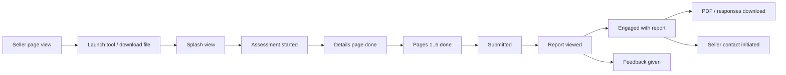

# M-GRAT Funnel Tracking Plan (Carbon Autotrack)

Plan for what to track across the whole journey: seller page → customer splash → assessment → report → feedback → seller hand-off.

Companion to [`autotrack-ids.md`](autotrack-ids.md), which is the registry of IDs that already exist. This document decides **what we need to know**, **what is already covered**, **what is missing**, and **what to build, in order**.

---

## 1. Audit: what is tracked today

### 1.1 Two tracking systems are in play

| System | How it fires | Where it is loaded | Notes |
|---|---|---|---|
| **Carbon Autotrack** | Click on any element with `data-autotrack-id` | `index.html`, `report.html`, standalone bundle | Declarative. No JS needed per event. Cannot express "on page 4 of 7" unless the ID encodes it. |
| **Vercel Analytics custom events** (`window.va?.("event", …)`) | Explicit JS calls | `index.html`, `report.html` only | Stripped from the standalone bundle by `scripts/bundle.py` (line ~534), so `window.va` is a no-op there. |

Consequence: **the self-serve HTML file only gets Autotrack click data.** Anything that needs to work in that delivery mode (page position, drop-off) must be expressible through Autotrack IDs, or must go through a second path we have not built yet.

### 1.2 Coverage by stage

| Stage | Autotrack today | Vercel `va` events today | Gap |
|---|---|---|---|
| **Seller page** (`docs/index.html`) | None. No Autotrack script in the file. | None | Entire stage is dark. |
| **Splash** (`index.html`) | `splash__btn--start-hero`, `splash__btn--start-cta` | `assessment_started` | No splash view event, no "left without starting". |
| **Assessment** | Back, Next, every radio/checkbox/text-input (dynamic IDs) | `assessment_page_advance {page}`, `assessment_page_back {from}`, `assessment_exit {page}`, `assessment_submitted {industry?}` | See 1.3. |
| **Report** | Seller CTAs, downloads, maturity maps, feedback, share modal, comparison-view toggle | `report_viewed`, `seller_contact_initiated {source}`, `report_feedback {value}` | Section navigation, stage-card expand, comparison config, follow-up form, tab switching are untracked. |
| **Feedback** | `report__feedback-btn--yes/no`, textarea, submit, cancel | `report_feedback` | Comment text is not (and should not be) captured. Follow-up form (`renderFollowUp`) has no IDs. |

### 1.3 Defects and gaps found in the existing instrumentation

Fix these before adding anything new. They corrupt the numbers we would build on.

1. **`assessment_exit` can double-fire.** `js/app.js` registers both `pagehide` and `visibilitychange → hidden`. The comment says "once per tab" but there is no guard. Switching tabs and then closing the tab fires it twice. Drop-off counts will be inflated.
2. **`assessment_exit` ignores page 0.** `trackExit` returns when `state.page === 0`. Page 0 is the "Session details" form (facilitator, customer, organization), and the first real step. Abandonment on it is invisible.
3. **Industry is never captured.** `app.js` reads `answers["__contact_industry"]` and `scoring.js` reads the same key, but `DETAILS_PAGE` in `app.js` only defines `__facilitator_name`, `__contact_name`, `__contact_organization`, and `data/assessment.js` has no such question. So `assessment_submitted` and `report_viewed` never carry `industry`. Either add the field, or remove the dead reads and drop "completion by industry" from the goals.
4. **Page identifiers are bare integers.** `assessment_page_advance {page: 3}` breaks if page order changes in the workbook. Pages have stable titles/IDs in `data/assessment.js`; use those.
5. **`docs/autotrack-ids.md` is out of date.**
   - Mobile nav and footer download items are plain `<button>`s with IDs `report__btn--download-pdf-*` / `report__btn--download-responses-*`, not `report__menu-item--*` as documented.
   - Missing from the registry: `report__dl-menu--mobile-nav`, `report__dl-menu--footer`, `report__btn--open-comparison-view`, `report__btn--share-modal-close`, `report__btn--share-modal-cancel`, `report__btn--share-modal-send`.
   - The naming convention table lists `component-type` values that do not include `dl-menu`.
6. **"Talk to a seller" and "Send report" record intent, not delivery.** Both open a `mailto:`. We cannot know whether the email was sent. Label the metric "seller contact initiated" everywhere and never call it a conversion.
7. **Feedback event drops the "No" reason by design.** `report_feedback {value}` has no comment, which is right for privacy, but we also have no coarse signal. See 4.5 for an optional structured reason.

### 1.4 Things I could not verify

- **What the Autotrack payload contains** (event name, whether it captures element text, input values, page URL, a session/anonymous ID, whether extra `data-*` attributes are forwarded). The registry says it produces a `UI Interaction` event with an `autotrack-id` property. I could not find public documentation to confirm more. **Confirm with the Carbon Autotrack team before relying on anything beyond the ID.**
- **Whether Autotrack is wired to Segment → Amplitude for this property.** `autotrack-ids.md` assumes Amplitude and Segment. Confirm the source/write key and the destination.
- **Whether text-input interactions capture values.** The three details fields hold names and an organization. If Autotrack captures `value`, that is PII leaving the browser. Must be confirmed (see 6.1).

---

## 2. Questions the funnel must answer

Grouped by the decision they support.

| # | Question | Decision it informs |
|---|---|---|
| Q1 | Of sellers who open the seller page, how many open the web tool, download the self-serve file, or neither? | Which delivery mode to promote. |
| Q2 | Which seller-page entry point (hero, approach section, bottom CTA) drives launches? | Layout and copy. |
| Q3 | Of customers who see the splash, what share start? | Splash effectiveness. |
| Q4 | Of those who start, what share **complete** (submit)? | Headline completion rate. |
| Q5 | **Where** do the rest drop off, by page and by question? | Which questions to shorten, reword, or make optional. |
| Q6 | Which required questions cause validation friction (repeated failed Next)? | Required vs optional, wording. |
| Q7 | How long does completion take, overall and per page? | Length budget for facilitated sessions. |
| Q8 | How often do people go back, and from where? | Confusing questions. |
| Q9 | Of completers, how many reach the report and engage with it (sections, stages, comparison view)? | Report value. |
| Q10 | Which report content gets used: expansion paths, stage cards, maturity maps, comparison? | Content investment. |
| Q11 | How many download a PDF or responses, and from which placement? | Hand-off preference. |
| Q12 | How many initiate seller contact, from which placement? | Business outcome. |
| Q13 | What share rate the report useful; what do the "No" raters say? | Quality signal. |
| Q14 | Do all of the above differ between facilitated web use and self-serve file use? | Whether the two modes need different design. |

---

## 3. The funnel



### 3.1 Funnel steps and their events

Every step must map to exactly one event so the Amplitude funnel is unambiguous.

| Step | Event | Source | Status |
|---|---|---|---|
| F0 Seller page viewed | page view for `docs/index.html` | Segment page call or Autotrack page load (confirm) | **Missing** |
| F1 Tool launched from seller page | `seller__btn--open-web-tool-*` | Autotrack | **Missing** |
| F1b Self-serve file downloaded | `seller__btn--download-self-serve-*` | Autotrack | **Missing** |
| F2 Splash viewed | `splash_viewed` | JS (see 5.2) | **Missing** |
| F3 Assessment started | `splash__btn--start-hero` / `-cta` | Autotrack (+ `assessment_started` on web) | Exists |
| F4 Page *n* completed | `assessment__btn--next` + page marker | see 4.3 | **Partial** |
| F5 Submitted | `assessment_submitted` | `va` only | Exists, web only. Needs an Autotrack-visible equivalent for self-serve. |
| F6 Report viewed | `report_viewed` | `va` only | Exists, web only |
| F7 Report engaged | section / stage / comparison IDs | Autotrack | **Missing** |
| F8 Download | `report__btn--download-*` | Autotrack | Exists |
| F9 Seller contact initiated | `report__btn--talk-to-seller-*`, `…share-modal-send` | Autotrack + `va` | Exists |
| F10 Feedback | `report__feedback-btn--*` | Autotrack + `va` | Exists |

---

## 4. What to track, per stage

### 4.1 Seller page (`docs/index.html`)

**Prerequisite:** add the Autotrack `<script type="module">` tag to `docs/index.html` (same snippet as `index.html` line 26). Without it nothing below fires. Also add the Vercel Insights tag only if this page is hosted where it can run; GitHub Pages / IBM mirror may not support it, in which case Autotrack alone must carry this stage.

New naming prefix: `seller__`.

| Proposed ID | Element | Why |
|---|---|---|
| `seller__btn--open-web-tool-hero` | Hero primary CTA (line ~1944) | Q1, Q2 |
| `seller__btn--open-web-tool-approach` | Approach-section CTA (line ~2043) | Q2 |
| `seller__link--open-web-tool-url` | The inline `cds-link` to the Vercel URL (line ~2031) | Q2 |
| `seller__btn--copy-web-tool-url` | "Click to copy" (line ~2032) | Sellers sharing the link instead of clicking; important for Q1 because a copy produces no launch from this page |
| `seller__btn--download-self-serve-approach` | Download self-serve HTML (line ~2072) | Q1, Q14 |
| `seller__btn--open-web-tool-cta` | Bottom CTA (line ~2273) | Q2 |
| `seller__btn--download-self-serve-cta` | Bottom CTA download (line ~2277) | Q2 |
| `seller__btn--hero-view-resources` | Hero secondary "#additional-resources" (line ~1948) | Content interest |
| `seller__btn--share-feedback-cta` | Feedback CTA to `wkf.ms` (line ~2300) | Q13 (seller-side) |
| `seller__link--share-feedback-tab` | Floating "Feedback" tab (line ~1882) | Same |
| `seller__link--share-feedback-footer` | Footer link (line ~4148) | Same |
| `seller__nav--overview`, `seller__nav--opportunity-paths` | Header nav items | View switching |
| `seller__accordion--guide-step-{1..5}` | The five guiding-section accordion items | Which guidance sellers read. Requires an event listener if Autotrack does not capture accordion toggles (verify). |
| `seller__switcher--track-{fsm,apm}` | Opportunity paths content switcher | Q10-style interest on the seller side |
| `seller__tab--stage-{n}` | Opportunity paths stage tabs | Same |
| `seller__link--resource-{apm-map,fsm-map,enablement}` | Additional resources links (lines ~2344–2365) | Resource use |
| `seller__btn--download-checklist` | Disabled "coming soon" | Demand signal for the unbuilt checklist. Disabled elements usually swallow clicks, so this will not register as written; see open question O3. |

**Cross-domain attribution.** The seller page and the tool live on different origins (`m-grat-beta-vercel.vercel.app`). Segment's `anonymousId` is per-origin, so the funnel cannot be stitched F0 → F2 from IDs alone. Add query parameters to the three launch links:

```
?utm_source=seller-page&utm_medium=referral&utm_content=hero|approach|cta|url
```

Then read them once on the tool's first load and attach them to `splash_viewed` (see 5.2). Keep the parameters out of the report/mailto content.

### 4.2 Splash (`index.html`)

| Proposed ID / event | Why |
|---|---|
| `splash_viewed` (JS, includes `utm_*`, `surface`) | Denominator for Q3. Today there is none, so splash → start conversion cannot be computed. |
| `splash__btn--start-hero`, `splash__btn--start-cta` | Exist. Keep. |
| Scroll depth marker: `splash_scrolled_to_cta` (IntersectionObserver on the bottom CTA section) | Separates "never scrolled" from "read it and left". Cheap and specific. |
| `splash__link--ibm-logo` | Only if leaving to ibm.com is a concern. Low priority. |

Do not track hover on the three value cards. No decision depends on it.

### 4.3 Assessment

This is the stage with the most value and the biggest gaps. Seven pages: **Session details** + six content pages (goals, maintenance operations, field service operations, asset performance, Maximo capabilities, organisational appetite).

#### 4.3.1 What to measure

| Metric | Definition | Needs |
|---|---|---|
| Completion rate | `assessment_submitted` ÷ `assessment_started` | Exists on web; add self-serve path |
| Per-page continuation | Users who advance from page *n* ÷ users who reached page *n* | Page marker on Next |
| Per-page exit | Last page seen before leaving, among non-submitters | Fixed `assessment_exit` (1.3 #1, #2) |
| Time on page | Seconds between page render and Next/Back/exit | Timer in `goTo`/`render` |
| Time to complete | Start → submit | Derived from the two timestamps |
| Validation friction | Count of blocked Next presses per page and per question | New `assessment_validation_failed` |
| Back-navigation rate | Back presses ÷ Next presses, per page | Exists as `assessment_page_back` |
| Back from page 0 to splash | Users who return to the splash | New (`showSplash()` call from Back on page 0 has no event) |
| Optional-question skip rate | For the optional "advanced practices" question on the "Your asset performance practice" page | Derive from answers at submit |
| Answer distribution | Which options are chosen | Already visible through per-option Autotrack IDs |

#### 4.3.2 Fixes to existing events

| Change | Detail |
|---|---|
| Guard `assessment_exit` | Add a module-level `_exitSent` flag; fire once. |
| Track page 0 exit | Remove the `state.page === 0` early return, or send `page_id: "details"` for it. Keep the `_submitted` guard. |
| Replace `page: <int>` with `page_id` and `page_index` | Use the stable page identifier/title from `assessment.pages`. Add `page_count`. |
| Add `time_on_page_s` to advance, back, and exit | Record `performance.now()` in `render()`. |
| Add `surface` | `web` or `self-serve`, set once. Needed for Q14. |
| Resolve industry | Add the field or remove the dead reads (1.3 #3). |

#### 4.3.3 New events

| Event | Fires | Properties |
|---|---|---|
| `assessment_validation_failed` | `handleNext` when `findFirstInvalid` returns an element | `page_id`, `question_id` of the first offender, `invalid_count` |
| `assessment_back_to_splash` | Back pressed on page 0 | none |
| `assessment_page_viewed` | `render()` | `page_id`, `page_index`, `page_count`, `entry` (`next`/`back`/`start`) |
| `assessment_completed_summary` | On submit, just before scoring | `duration_s`, `back_count`, `validation_failures`, `optional_answered` (bool). Aggregated session summary, so one event answers Q7 without stitching. |
| `assessment_scoring_failed` | `.catch` in the scoring chain (redirects to `report.html?fallback=1`) | none. Today a scoring failure silently sends the user to mock data and `report_viewed` is labelled `demo: true`. A failure counter makes this visible. |

#### 4.3.4 Autotrack IDs on controls

The existing dynamic IDs (`assessment__radio--{questionId}-{value}` etc.) are good for answer distribution but **cannot show page position**, and every answer click is an event. For drop-off, rely on the page-level events in 4.3.3, not on aggregating control clicks.

Decisions:

- **Keep** the dynamic IDs for answer distribution. Do not add more.
- **Do not** put page position into every control ID. The `page_viewed` event covers it with less noise.
- **Details-page text inputs**: see 6.1 before keeping `assessment__text-input--__*`.

#### 4.3.5 Self-serve gap

`window.va` does not exist in the standalone file, so none of 4.3.2–4.3.3 will be recorded there. Options, in order of preference:

1. **Route page-level events through Autotrack-visible markers.** Add a visually hidden, non-interactive marker updated per page, or have `goTo()` programmatically emit the event Autotrack listens to. This depends on how Autotrack observes interactions, which I could not verify (O1).
2. **Call Segment directly** (`window.analytics?.track`) if the Autotrack tag exposes it. Also unverified.
3. **Accept the gap** and report self-serve using only Next/Back click IDs, with a clear caveat in every dashboard.

Do not start building until O1 is answered. It decides the whole design for self-serve.

### 4.4 Report

All interactions inside the report are post-completion, so the question is engagement, not conversion.

#### 4.4.1 Already covered (keep)

Seller CTAs (mobile nav, sidebar, footer, expansion APM/FSM, Schedule review), download menus and items, maturity map buttons, feedback buttons, share-modal buttons (IDs exist but are not in the registry), comparison-view toggle.

#### 4.4.2 Missing

| Proposed ID | Element | Why |
|---|---|---|
| `report__nav--section-{act-today,act-roi,act-plan,act-resources,act-improve}-sidebar` | `.report-nav__item` links (report.html lines 126–130) | Q9, Q10. Which sections get navigated to. |
| `report__nav--section-{…}-mobile-nav` | `.mobile-nav__item` links (lines 68–78) | Same, mobile |
| `report__btn--stage-toggle-{apm,fsm}-{n}` | `[data-rail-toggle]` and `[data-rail-index]` in `renderStageRail` | Q10. Which stage cards people expand. Dynamically rendered, so the IDs must be added in the template string in `js/report.js`. |
| `report__btn--compare-config` | `#compare-config-btn` | Comparison view use |
| `report__select--compare-track`, `…compare-stage-a`, `…compare-stage-b` | Comparison config selects | What people compare |
| `report__btn--compare-done` | `#compare-config-done` | Config completion |
| `report__tab--established-{n}` | Established-practices tabs (`.established-panel`) | Tab use |
| `report__btn--download-menu-trigger-{mobile-nav,footer}` | `.dl-menu__trigger` buttons | Menu open vs item chosen; shows hesitation |
| `report__btn--followup-submit` plus per-control IDs | `renderFollowUp` output | See 4.5 |

**Rule for dynamic IDs:** append the stage or track key (as in `report__btn--talk-to-seller-expansion-${track}`), never a user-supplied string.

#### 4.4.3 Events, not clicks

| Event | Fires | Why |
|---|---|---|
| `report_section_viewed {section_id}` | IntersectionObserver, once per section, ≥50% visible for ≥2 s | Reading depth. Scrollspy already exists (`initScrollSpy`), so hook the same state change. This captures reading, which clicks cannot. |
| `report_pdf_printed` | `afterprint` after a `pdfAction` call | Distinguishes "clicked Download PDF" from "actually reached the print dialog and finished". The two can differ. Note Safari/Firefox also fire print events for Cmd+P; record `trigger: "menu"` when the app initiated it. |
| `report_responses_printed` | `afterprint` in `initResponsesDownload` | Same, for the responses document |
| `report_time_on_page_s` | `pagehide`, once | Engagement duration. Use the same once-only guard as the exit fix. |

#### 4.4.4 Demo and fallback traffic

`report_viewed` already carries `demo: true` for mock data. Add `fallback: true` when the URL has `?fallback=1`. Every report dashboard must filter `demo = false`, or the numbers include sessions where scoring failed.

### 4.5 Feedback

| Item | Plan |
|---|---|
| Rate | `report__feedback-btn--yes` ÷ (`yes` + `no`), plus response rate = answered ÷ `report_viewed`. |
| Negative reason | **Optional, only if we want a coarse signal.** Add a small `cds-dropdown` or three radio options before the free-text box ("Missing information", "Unclear", "Not relevant to us", "Other"). Track the choice as `report__radio--feedback-reason-{key}`. **Never** send the free-text comment to analytics. |
| Abandonment | `report__btn--feedback-cancel` after `…feedback-btn--no` shows the user opened the form and backed out. Already covered. |
| Follow-up form | `renderFollowUp` renders questions into `#followup-form`, but `report.html` has no `#followup-form` element (grep found only `#feedback-actions`), so it is currently not shown. Do not instrument it. If it is re-enabled, add IDs then. |
| Seller-side feedback | Covered in 4.1 (links to `wkf.ms`). |

### 4.6 Seller hand-off

All sources should resolve to one funnel step, "seller contact initiated", with `source` identifying placement.

| Source | ID / value |
|---|---|
| Mobile nav | `report__btn--talk-to-seller-mobile-nav` |
| Sidebar | `report__btn--talk-to-seller-sidebar` |
| Footer | `report__btn--talk-to-seller-footer` |
| APM / FSM expansion card | `report__btn--talk-to-seller-expansion-{apm,fsm}` |
| Schedule review (accelerate card) | `report__btn--schedule-ibm-review` |
| Share modal | `report__btn--share-modal-send` (and `va` `source: "share_modal"`) |

Add `share_modal_shown` so the modal's own conversion (shown → send / cancel / dismiss) is measurable. Currently only the three buttons are tracked, so a user who presses Escape or clicks the backdrop leaves no trace.

---

## 5. Implementation plan

### 5.1 Phases

| Phase | Scope | Why this order |
|---|---|---|
| **0. Answer open questions** | O1–O4 below | Several designs depend on what Autotrack can do. |
| **1. Correct existing data** | 1.3 #1, #2, #3, #4; add `surface`; `fallback` flag | Everything else is built on these numbers. Small, low-risk edits. |
| **2. Seller page** | Add Autotrack tag, IDs from 4.1, UTM parameters on launch links | Opens the front of the funnel. Independent of the tool's JS. |
| **3. Assessment drop-off** | 4.3.2, 4.3.3, `splash_viewed` | Highest decision value (Q4–Q8). |
| **4. Report engagement** | 4.4.2, 4.4.3, share modal events | Q9–Q12. |
| **5. Feedback refinement** | Optional reason capture (4.5) | Lowest priority. |
| **6. Dashboards and QA** | Amplitude charts, verification checklist (section 7) | Done last, repeated after each phase. |

### 5.2 Files touched

| File | Change |
|---|---|
| `docs/index.html` | Autotrack tag; `data-autotrack-id` on seller CTAs and links; UTM query params |
| `index.html` | `splash_viewed` hook; no new IDs needed |
| `js/app.js` | Fix `trackExit`; add page timing, `page_id`, validation, back-to-splash, summary events; `surface` |
| `report.html` | IDs on `.report-nav__item`, `.mobile-nav__item`, `.dl-menu__trigger`, compare-config controls |
| `js/report.js` | IDs inside `renderStageRail`; section-viewed observer; print-completed events; `fallback` flag; `share_modal_shown` |
| `docs/autotrack-ids.md` | Bring up to date with every ID added, plus the corrections in 1.3 #5 |
| `data/*.js`, `Logic/*.xlsx` | **Do not edit.** Page identifiers come from the existing generated data. |

### 5.3 Build constraints from `AGENTS.md`

- After any change to `js/*.js` or `css/*.css`, run `python3 scripts/bundle.py` from the project root and confirm `verify_bundle()` passes.
- `bundle.py` patches `app.js` and `report.js` by literal string. Do **not** rename or restructure: the `import("./scoring.js").then(...)` block, `async function init(`, `const nextLabel = …`, `function loadStoredResponses()`, the `await Promise.all(...)` block for custom elements, or the `"Talk to a seller"` text.
- `bundle.py` strips Vercel Insights from the standalone. Any new analytics call must be `window.va?.(…)`-safe (optional call) so it is harmless there.
- Put the analytics calls behind one small helper (for example `track(name, data)` in `app.js` / `report.js`) so adding the self-serve path later is a single change. Keep it as plain code in each file; do not introduce a new module without checking that `bundle.py` inlines it.
- If a feature touches what prints (print events, downloads), follow `PRINT-GUIDE.md` and verify with a real PDF.

### 5.4 Event naming

- **Autotrack IDs**: `[screen]__[component-type]--[descriptor]`, as in the registry. Add `seller` to the `screen` list and `nav`, `select`, `tab`, `link`, `switcher`, `accordion` to `component-type`.
- **JS events**: `snake_case`, `noun_verb` (`assessment_started`, `report_viewed`). Keep the existing names; do not rename live events.
- **Properties**: `snake_case`. Reuse `page_id`, `page_index`, `industry`, `source`, `surface`, `demo`, `fallback`.

---

## 6. Privacy, compliance, and data quality

### 6.1 Personal data

- Details-page inputs hold **a person's name, a facilitator's name, and an organization**. Confirm that Autotrack does not capture `value` or element text for `cds-text-input`. If it does, remove `data-autotrack-id` from those three inputs and track the page through `assessment_page_viewed` instead.
- Never send: free-text feedback comments, names, organization, email body, or any answer text.
- `mailto:` bodies contain full responses. Analytics must record only that the click happened, never the body.
- Confirm consent and cookie requirements for `s81c.com` Autotrack and Vercel Analytics. The seller page footer has a "Cookie Preferences" link (`href="#"`), and the tool has none. Check whether this property needs a consent gate.

### 6.2 Sample size

The tool is used in facilitated sessions, so volumes are likely small. Per-question exit analysis will be noisy. Report per-page rates first and only drill into questions once a page shows an outlier. State `n` on every chart.

### 6.3 Test traffic

Seller training, demos, and QA all look like real sessions. Add a way to exclude them (for example a `?demo=1` flag that sets `demo: true` on all events, extending the existing `demo` property), and document it for the team.

### 6.4 Two surfaces, two datasets

Web (Vercel) and self-serve file will have different event coverage until O1 is resolved. Every chart that mixes them must either filter `surface` or carry a note.

---

## 7. Verification checklist

Run after each phase, in the web build and the standalone bundle.

1. Load each page with the network panel open; confirm the Autotrack script loads and a request fires per click.
2. Run the registry console snippet to list live IDs and compare against `autotrack-ids.md`:
   `document.querySelectorAll('[data-autotrack-id]').forEach(el => console.log(el.dataset.autotrackId))`
3. Walk the full path once with no errors: seller page → splash → 7 assessment pages → report → feedback "No" → submit → seller CTA. Confirm each step shows up once, in order.
4. Abandon at page 0, page 3, and the final page; confirm exactly **one** `assessment_exit` each (guards the double-fire bug).
5. Press Next with required fields empty; confirm `assessment_validation_failed`.
6. Press Back from page 0; confirm `assessment_back_to_splash`.
7. Break scoring (for example block `scoring.js`); confirm `assessment_scoring_failed` and `report_viewed` with `demo`/`fallback`.
8. Open the standalone file offline, then online; confirm what is and is not captured, and that no console errors come from `window.va` being absent.
9. Run `python3 scripts/bundle.py` and confirm `verify_bundle()` passes.
10. Print a real PDF and check output is unchanged (`PRINT-GUIDE.md`).

---

## 8. Amplitude charts to build

| Chart | Definition |
|---|---|
| **Headline funnel** | seller page viewed → launch/download → splash viewed → started → submitted → report viewed → seller contact initiated. Filter `demo = false`. |
| **Assessment drop-off** | Funnel through `assessment_page_viewed` for `page_index` 0–6, then `assessment_submitted`. |
| **Exit by page** | `assessment_exit` grouped by `page_id`, as a share of those who reached the page. |
| **Time on page** | Median `time_on_page_s` by `page_id`. |
| **Validation friction** | `assessment_validation_failed` by `question_id`. |
| **Back-navigation** | `assessment_page_back` by `from`. |
| **Launch source** | Splash views and starts by `utm_content`. |
| **Report engagement** | Unique users per `report_section_viewed` section; `report__btn--stage-toggle-*` counts. |
| **Hand-off by placement** | `seller_contact_initiated` grouped by `source`. |
| **Download preference** | PDF vs responses; by placement; clicked vs printed. |
| **Feedback** | Yes / No ratio; response rate; cancel rate. |
| **Surface comparison** | Key rates split by `surface`. |

---

## 9. Open questions

| # | Question | Blocks |
|---|---|---|
| O1 | What does Autotrack actually capture, and can the page code emit custom events or properties through it? Does it expose `window.analytics`? | The self-serve design (4.3.5), `surface`, and page-level events there. |
| O2 | Is the property wired to Segment → Amplitude, and which write key? | All dashboards. |
| O3 | Does Autotrack record clicks on `disabled` elements? | `seller__btn--download-checklist` and `report__btn--download-checklist`. If not, use a wrapper element. |
| O4 | Does Autotrack observe `cds-accordion`, `cds-tabs`, and `cds-content-switcher` interactions, or only clicks on `data-autotrack-id` elements? | Seller accordion, tab, and switcher tracking. |
| O5 | Is the industry field wanted? If yes, which page and which options? | 1.3 #3 and any by-industry analysis. |
| O6 | Is a consent banner required for this property? | Rollout. |
| O7 | Which hosting serves `docs/index.html` (GitHub Pages, IBM mirror)? Does Vercel Insights work there? | Seller page tracking approach. |
